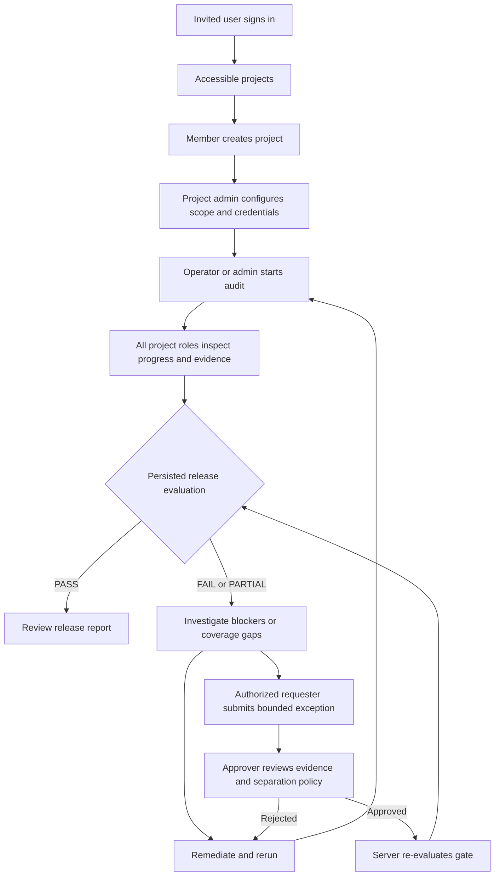

# Kase web app — product requirements

Version 1.0 · 12 September 2026 · Proposed delivery contract grounded in the current repository.

## 1. Product purpose

Kase helps engineering teams audit a running application and its source, connect observed behavior to evidence and source context, and make an explainable release decision. The web app must let a team set up authorized testing, operate audits, investigate findings, and govern exceptions without developer assistance.

The system of record is persisted audit execution, validated findings, evidence, and deterministic policy evaluation. AI explains and proposes; the interface must never turn AI prose into a release verdict.

### Problems to solve

- QA/engineers need a reproducible defect, its source context and a useful fix, rather than disconnected tool output.
- Operators need progress, scope, request budgets and failure recovery while tests run.
- Leads need a defensible release outcome with visible gaps and exceptions.
- Administrators need clear access, credentials, authorized targets, retention and integration controls.

### Delivery stages

| Stage | User value | Inclusion |
|---|---|---|
| A: Operational console | Set up → run → inspect proof | Authentication, capabilities, projects/settings, audit wizard/detail, findings/evidence, inventory, tokens/secrets/retention; verified M4 controls only when available |
| B: Release assurance beta | Explain decision → triage → approve exception → verify remediation | Correlation/lifecycle, coverage/budget completion, gates, waivers/suppressions, reports, GitHub/Jira, member/invite administration and audit trail |

Stage A is not the complete release-assurance product. If invite/member administration is not delivered in A, label provisioning as operator-assisted and document the supported operations procedure. B cannot pass self-service acceptance without it.

Out of scope: billing/subscriptions, public self-signup, custom role builders, super-admin impersonation, multi-organization switching, self-healing code changes, device farms, visual regression, broad load testing, and deferred scanners in `TASKS.md`. No platform “super admin” role exists in the inspected authorization model.

## 2. People, actors, and role model

“User” describes a person, not a fifth project role. A person has an organization relationship and one assigned role per project. Organization and project permissions must be shown separately. Job personas such as engineer and release lead map onto roles; they do not add permissions.

| Actor/role | Typical responsibility | Landing experience |
|---|---|---|
| Anonymous visitor | Understand product, request access or report a concern | Public homepage/docs; sign-in for invited users |
| Pending invitee | Authenticate using the invited verified email | Sign-in; specific denial/recovery state if invitation is invalid |
| Organization member | Belong to organization; access assigned projects; currently may create a project | Project selection or no-project state with creation/access guidance |
| Organization admin | Organization governance and evidence-retention defaults | Organization settings; project work only with a project grant |
| Project viewer | Read audit results, evidence, inventory and eventual reports | Project overview and read-only investigation |
| Project operator | Run/cancel audits; eventual replay, Jira and waiver requests | Project overview with audit actions |
| Project approver | Review release exceptions, false positives and accepted risk | Approval queue plus evidence/gate context |
| Project admin | Configure project, repositories, targets, scope, credentials, tokens, policies and integrations | Project overview with settings/setup actions; start/cancel explicitly permitted today |
| API token / CLI / CI | Project-scoped automation with one of the same four roles | No browser session or organization administration; actions appear in history |
| System/worker | Execute persisted jobs and produce deterministic records | No interactive human permissions; clearly attributed activity |

### Permission matrix

I = implemented API permission; S = existing specification, pending workflow implementation; P = proposed permission requiring server agreement; — = denied. Every project permission requires membership in that project or a matching project token. Public resources are separate.

| Action | Viewer | Operator | Approver | Project admin |
|---|---|---|---|---|
| Read project/audits/jobs/findings/evidence/inventory | I | I | I | I |
| Start/cancel audit | — | I | — | I |
| Read scope/repository/target configuration | I | I | I | I |
| Modify project/repositories/targets/scope | — | — | — | I |
| List/create/revoke tokens; manage secrets | — | — | — | I |
| Read project retention policy | I | I | I | I |
| Update project retention override | — | — | — | I |
| Read AI configuration/test identities/agent runs | I* | I* | I* | I* |
| Change AI configuration; create/deactivate test identities | — | — | — | I* |
| Read eventual gates/waivers/reports | S | S | S | S |
| Replay finding | — | P | — | P |
| Create Jira issue | — | S | — | P |
| Request waiver | — | P | P | P |
| Approve waiver; mark false positive/accept risk; manage suppressions | — | — | S | — |
| Configure gate policies/integrations | — | — | — | S |
| View project audit trail | — | — | P | P |
| Manage project membership | — | — | — | P |

*M4 source in progress; not verified as released by this review. Raw secret values are never readable by any role. Token plaintext is returned once on creation.

Organization permissions:

- Current project list/create routes require an organization-bound browser session, not project tokens. Organization member and admin may create a project; the creator becomes its project admin. Changing this to org-admin-only requires a backend/product decision.
- Updating organization retention defaults requires an explicit organization admin membership. A project admin cannot substitute for it. Reading organization policy is session/org scoped.
- Invitation lifecycle and organization membership administration are proposed organization-admin-only workflows. Project admin may manage membership only within their own project, through a server-controlled role-assignment policy.
- Approver is separate from operator/admin. When separate approval is required, requester and approver must differ even if the requester has the approver role. The server is authoritative.
- Changing membership to acquire approval authority can defeat separation of duties. Before B, define who may assign approver, last-admin protection, and audit review of role changes. Do not solve this by silently making admin all-powerful.

## 3. Information architecture and screen contracts

Global shell: organization name, accessible project selector, current project role, breadcrumbs, primary navigation, account/sign-out, and contextual help. Organization settings sit outside project navigation. Do not mix public marketing navigation into authenticated task pages.

The companion [screen, layout, and flow specification](04-screen-layout-flow-spec.md) expands this section into concrete page sections, responsive layout rules, role-specific surfaces, and flow maps for frontend implementation.

| Screen | Main information/actions | Required exceptional states |
|---|---|---|
| Sign-in/access | Configured identity providers; invited-email guidance; validated return path | No provider, denied email, expired/missing invite, provider error, expired session |
| Projects | Name, accessible role, last audit and timestamp; eventual gate, severity trend, expiring waivers | No projects, no access, failed load, stale last audit, unevaluated gate |
| Project overview | Setup completion or last audit; target/commit/provenance; coverage; findings and inventory drift | Never run, running first audit, degraded/failed audit, no gate evaluation |
| New/edit project | Name/slug, repositories, targets, scope/attestation; credential references | Duplicate slug, invalid host, revoked secret, unsaved edits, re-attestation required |
| New audit | Mode, eligible categories, target/repository, commit, time/request scope summary | Missing prerequisite, unsupported category, scope denial, submission uncertain, duplicate retry |
| Audits list/detail | History; live jobs/retries/durations; provenance; degradation; budgets; findings | Queued, running, completed, partial, failed, cancelled, lost connection, permission revoked |
| Findings list | Severity/category/status/origin/eligibility/correlation/patch filters; evidence-linked rows | No findings, filter no-match, partial coverage, unsupported filter, paginated load error |
| Finding detail | Claim, impact, reproduction, raw evidence, source/correlation, patch, history and role actions | Advisory only, unverified source, no patch, evidence purged, replay failure, possible match |
| Evidence viewer | Artifact metadata/type/hash/time/class; redacted preview; authenticated download | Unsupported/binary type, oversized content, unavailable/expired artifact, integrity error, denied access |
| Endpoint inventory | Method/path template, sources, auth, handler if available, previous-audit drift | Inventory building, baseline absent, no endpoints, unavailable code mapping |
| Gate detail/history | PASS/FAIL/PARTIAL, exact policy version, rules/blockers/evidence, coverage, commit, waivers | No evaluation, evaluating, stale result, expired waiver, failed evaluation |
| Waivers/approvals | Pending requests, active/expired/rejected/revoked entries; reason, requester, approver, release/expiry | Self-approval denied, stale request, conflicting decision, expired request/evidence |
| Reports | Audit-specific report and supported exports; executive summary plus evidence links | Report building, failed generation, outdated evaluation, unavailable artifact |
| Project settings | General, repositories, targets, scope, tokens, secrets, retention; later members, policy, AI and integrations | Read-only access, validation/conflict, revoke consequences, missing backend capability |
| Organization settings | Members/invitations, default retention, administrative history | Admin required, no members matching search, expired invite, last-admin removal denied |

No metric may display zero when the source is absent. Use “Not available,” “Not evaluated,” “Not run,” or “No findings in executed categories,” according to the actual state.

## 4. Functional requirements

### FR-01 — Identity and access

Use invite-only verified provider sign-in. Restore safe internal deep links after authentication. Show current org/project context and role. Supply sign-out. Handle access loss during a session immediately on the next denied response, clear protected client state and offer a valid destination. Never elevate via hidden controls or client-only checks.

### FR-02 — Project activation and safe setup

Create a project with a mandatory scope policy and named authorization attestation. Collect allowed hosts, denied paths, max requests/second, max requests/audit, target environment and destructive-testing preference (off by default). Explain that authorization to run tests is separate from login access. Repository and target setup can be staged after creation. Private credentials use project secret references, never inline values in URLs or saved browser drafts. Production target changes must surface the backend's re-attestation requirement.

### FR-03 — Audit operation

Offer only supported modes/categories and make missing prerequisites actionable. Review target/environment/scope/request caps before dispatch. Prevent duplicate submission and reuse the same idempotency key for retry of the same intent. Navigate to the returned audit. Cancellation requires a confirmation showing the affected target and run; show cancellation requested until persisted terminal state arrives. Never promise cancellation removed existing evidence.

### FR-04 — Live audit and honest coverage

Stream persisted events, show last-updated and disconnected indicators, reconnect/resume, and refresh every 10 seconds while disconnected. Keep job states, execution coverage and budget/degradation visible. Completed execution and release evaluation are separate. Show skipped/blocked categories with reasons and passing checks alongside findings. Do not generate a percentage from jobs of unequal duration unless the backend supplies a defensible denominator.

### FR-05 — Investigation

Default findings ordering is gate-eligible first, then severity, then confidence band once supported server-side. Preserve advisory findings. Each claim links to its supporting evidence. Distinguish deterministic source correlation from AI inference, label AI text, show verified/unverified commit provenance, and expose reproduction/patch copy actions only when content exists. A suggested patch is never shown as already applied or verified.

### FR-06 — Governance and release decisions

Display the persisted policy evaluation with its exact version, commit, timestamp, blocking rules, evidence and waivers. A user must be able to answer “Why did this fail?” without interpreting an opaque score. Waivers are fingerprint-scoped, require a reason and expiry, retain their full approval trail, and obey separate-approver policy. False-positive/suppression actions require approver and a reason. Expiring waivers appear approximately seven days ahead, with exact expiry and timezone.

### FR-07 — Remediation and lifecycle

Present backend-controlled states `new`, `open`, `fixed`, `verified`, `regressed`, `not_reproduced`, `false_positive`, `accepted_risk`. Do not equate not reproduced with fixed or verified. A new audit updates identity history through backend lifecycle logic; the browser does not infer resolution from a missing row. Possible matches require a human review queue rather than silent merge.

### FR-08 — Administration and integrations

Admins manage credentials through metadata-only lists, token plaintext once, explicit revoke/rotate feedback, retention inheritance, and later immutable gate-policy versions and integrations. Org admins manage invitations and organization membership once those contracts exist. GitHub/Jira status must distinguish queued delivery, successful delivery and retryable failure; issue deduplication belongs to the server and is keyed on fingerprint. Test identities are target testing accounts, not Kase access roles.

## 5. User flows

The complete journey below spans both stages; gate and exception steps depend on Stage B backend work.

### UF-01 — Invitee → first usable session

Organization admin provisions invite → invitee opens sign-in → chooses configured provider → provider verifies identity/email → invitation resolution allows access → load current-user capabilities → route to requested accessible project or projects list. If no invite/expired invite/unverified email, remain outside workspace and show a specific recovery action. A user with no project grant receives the no-project state, not a permission-error loop.

### UF-02 — Member/project admin → first project

Projects → Create project → enter name/slug and attested scope → optionally add public repository/target → review → submit → creator enrolled as project admin → project setup checklist. For private credentials: create project first → create project secret → attach repository/target using returned secret ID. Validate each step; preserve nonsecret entries on error. Duplicate slug keeps the user in the form. An operator/viewer on an existing project cannot edit that project's settings merely because they can create their own project.

### UF-03 — Operator/admin → run and monitor audit

Project → Run audit → choose supported mode/categories → choose required repository/target and commit → inspect scope and budgets → start once → audit detail → queued/running jobs and events → findings/evidence as available → persisted terminal state. Lost stream shows stale data and 10-second refresh; reconnect resumes by event sequence. Scope/attestation/AI prerequisite failure returns an actionable message and admin setup link where authorized. Cancel → confirmation → request accepted → terminal state when confirmed by server.

### UF-04 — Viewer/engineer → understand and fix a finding

Project/audit → filtered findings → finding detail → reproduction and evidence → source/correlation/provenance → impact and proposed patch → copy reproduction/patch → fix in normal development workflow → authorized operator runs another audit → inspect backend identity history. Viewer has no mutation controls; engineer needing execution gets an access explanation. Purged evidence retains its metadata/tombstone and clearly limits verification. Advisory evidence never silently becomes release blocking.

### UF-05 — Requester/approver → temporary exception

Finding or failed gate → authorized requester enters reason, fingerprint/release scope and expiry → submit pending request → approver queue → inspect finding/raw evidence/policy/expiry/requester → approve or reject with reason → server records decision → authoritative gate re-evaluation → UI refreshes outcome and history. If requester equals approver under separate-approval policy, deny approval. Concurrent decisions require reload; expiry removes applicability through backend policy evaluation and remains visible in history. This entire request lifecycle is pending backend work.

### UF-06 — Approver → false positive or accepted risk

Finding → review evidence → choose permitted disposition → enter reason (and bounded exception details when risk acceptance maps to a waiver) → confirm → backend creates suppression/waiver and history → refresh identity and evaluation. Reversing suppression changes future filtering; it must not fabricate historical findings. “Accepted risk” must not be used as a permanent ignore shortcut around waiver expiry.

### UF-07 — Project admin → safe credential/settings change

Settings → select token/secret/target/policy → inspect metadata and affected configuration → edit/rotate/revoke → confirm consequences → server mutation → refreshed metadata and history. New token plaintext shown once with copy and acknowledgement; closing loses access to the plaintext. Secret rotation never reveals the old value. Production-target changes lead to re-attestation before the next run.

### UF-08 — Organization admin → govern access and retention

Organization settings → invite verified email with expiry and explicit project assignments → pending/accepted/expired status → resend/revoke through server → member/project grants updated → affected users see changes at next access check. Separately set organization retention defaults → review affected inheritance → save → project overrides remain explicit. Last-admin and approver-assignment restrictions must be enforced by the future server endpoints. An organization admin without a project grant cannot inspect that project's findings.

### UF-09 — Release lead/CI → decision and follow-up

CI project token starts audit → persisted results → policy evaluation → GitHub check/report → lead opens linked gate → inspects blockers, coverage, provenance and waiver expiry → fix or request exception → rerun/re-evaluate → persisted outcome updates integration. FAIL/PARTIAL/failed evaluation do not authorize release. Missing integration or report backend is shown as unavailable, never simulated success.

### UF-10 — Any authorized reader → endpoint drift

Audit → Inventory → baseline or previous audit selected by supported backend behavior → method/path/source/drift filters → endpoint detail → linked handler/finding when available. First snapshot says “No previous baseline”; inventory-building response shows progress rather than empty success. Removed endpoints do not automatically imply fixed vulnerabilities.

## 6. User stories and testable acceptance

| ID / stage | Story | Acceptance criteria |
|---|---|---|
| US-01 A | As a visitor, I want to understand Kase and request access | Public routes work without a session; submission has pending/success/error states; no workspace access is granted by intake |
| US-02 A | As an invitee, I want to sign in to the intended project | Valid verified invited identity reaches an accessible return path; invalid/expired/unverified cases show recovery without creating unauthorized access |
| US-03 A | As an org member, I want a clear first-project path | Empty state explains access/creation; successful creation includes scope and grants creator admin; no token can use org routes |
| US-04 A | As a viewer, I want to inspect results safely | Authorized reads work; start/cancel/settings/approval are denied by API; deep links and reload preserve context |
| US-05 A | As an operator, I want to start exactly one audit | Required fields match selected mode; double-click and same-intent network retry resolve to one persisted audit |
| US-06 A | As an operator, I want trustworthy progress and cancellation | Disconnect displays stale timestamp and refresh; reconnect does not duplicate events; cancel remains pending until server confirms terminal state |
| US-07 A | As an engineer, I want evidence behind a claim | Finding has evidence navigation; unavailable artifact is explicit; unverified provenance/advisory/AI labels are visible; absent patch is not an empty fake diff |
| US-08 A | As a reader, I want to inspect attack-surface change | Inventory filters match server results; no baseline and not-ready are distinct; cross-project endpoint data is inaccessible |
| US-09 A | As a project admin, I want to configure safe tests | Scope validation is inline; production mutation prompts re-attestation; revoked/cross-project credentials cannot be attached |
| US-10 A | As a project admin, I want controlled tokens/secrets | Only admin can list/manage; token plaintext appears once; secret responses and browser persistence contain no retained plaintext |
| US-11 A | As an org admin, I want retention defaults | Org admin can save; project admin alone cannot; project inheritance/override states and expiry effects are explicit |
| US-12 A/B | As a project admin, I want supported AI configuration | Feature available only after verified M4; model choices come from supported catalog; invalid budgets/credentials return useful errors; no catalog/pricing is invented |
| US-13 B | As a release lead, I want an explainable verdict | Gate shows exact commit/policy/time/rules/evidence; PASS, FAIL, PARTIAL and no evaluation are visibly distinct |
| US-14 B | As an operator, I want a time-bound waiver request | Reason/fingerprint/expiry required; pending state retained; no request auto-approves or immediately changes gate |
| US-15 B | As an approver, I want independent exception review | Self-approval denied when configured; concurrent approval rejected/refreshed; approval has actor/time/reason/expiry and triggers authoritative re-evaluation |
| US-16 B | As an approver, I want accountable suppression | Reason required; history retained; undo affects future filtering; admin/operator cannot invoke approver-only mutations |
| US-17 B | As an org admin, I want to invite and manage members | Invite status/expiry/project grants visible; revoke/resend reliable; project admin cannot assign org admin; last-admin protection and approver-assignment rules tested |
| US-18 B | As a developer, I want a Jira issue without duplicates | Authorized issue creation returns external link; repeated fingerprint maps to the existing issue; integration failure allows safe retry |
| US-19 B | As a lead, I want a shareable report | Report is tied to audit/commit/evaluation and authorized access; generation/error state explicit; evidence links honor retention/access |
| US-20 B | As a CI maintainer, I want attributable release checks | Project token cannot cross scope or manage org; actor is identified as token; release check reflects persisted gate and delivery errors |
| US-21 A/B | As a keyboard/screen-reader user, I want the complete workflow | Main landmarks, field errors, dialogs, tables and live states are usable; focus restored; zoom/reduced motion do not hide actions |
| US-22 A/B | As a user whose access changes, I want a clear safe recovery | Next denied read/mutation clears protected state, ends streams and gives navigation/sign-in guidance without revealing another project's data |

## 7. Nonfunctional and display requirements

- Meet the repository's WCAG 2.1 AA target; automated axe checks plus manual keyboard, focus, zoom and screen-reader checks on critical flows. Color alone never conveys severity/outcome.
- Responsive acceptance at 360, 768, 1280 and 1440 CSS pixels; no page-wide horizontal overflow. Code/table panes may scroll with clear labels. Preserve critical evidence and governance actions on small screens.
- Proposed performance targets: field p75 LCP ≤2.5s, INP ≤200ms, CLS ≤0.1; validate on representative hardware/network before claiming them. Lazy-load large evidence, code rendering and nonessential visualizations.
- Preserve filters/tabs/cursors in URLs; do not store credentials/evidence in URLs, localStorage, analytics or error telemetry. Render all target-provided evidence and AI text as untrusted content.
- UTC storage, local display with explicit timezone and exact timestamp available. Expiry is server-authoritative. Counts/dates use locale-aware formatting.
- Mutations provide pending/error/confirmation feedback. Authentication, authorization, validation, resource absence, conflicts and server failures have distinct recovery paths.
- Historical execution, policy version and evidence identity must remain inspectable. The frontend cannot rewrite history when today's configuration changes.

## 8. Measurement and release acceptance

Targets below are proposed product targets, not current measurements. Instrument only coarse navigation/action outcomes with opaque IDs; exclude source, findings text, evidence, secrets and invite email from analytics payloads.

| Measure | Definition | Initial target |
|---|---|---|
| Activation | Invited pilot user completes project setup and dispatches a valid audit without builder assistance | At least 4 of 5 pilot users |
| Time to first dispatch | First successful sign-in to accepted audit submission, excluding external credential provisioning | Median ≤15 minutes in pilot |
| Time to inspect proof | Finding opened to relevant evidence opened | Median ≤30 seconds in usability test |
| Decision comprehension | Lead correctly explains blocker or incomplete coverage from gate screen | At least 4 of 5 pilot users |
| Authorization regressions | Successful unauthorized mutations/cross-project reads in required test matrix | Zero |
| Stream recovery | Disconnect/reconnect exercises preserving correct final state | All required scenarios pass |

Stage A exit: US-01–11, supported portion of US-12, US-21–22 pass with deployed supported APIs; a non-fixture project completes setup → audit → findings/evidence/inventory without direct database editing during the workflow. Seeded/invite provisioning must be explicitly disclosed if still assisted.

Stage B exit: all stories pass; two audits of an unchanged commit preserve deterministic fingerprints/gate outcomes as required by the roadmap; a seeded defect blocks with evidence, remediation changes the decision appropriately, separate approval and waiver expiry are exercised, and an independent pilot user completes onboarding without operator assistance.

## 9. Decisions to close without blocking independent Stage A UI work

| Decision | Recommended default | Owner / due |
|---|---|---|
| Organization project discovery | Return accessible projects by default, with explicit role metadata | Product + backend, before project browser integration |
| Project creation permission | Preserve current org-session-member behavior | Product/security, before onboarding release |
| Approver assignment authority | Explicit audited policy; no implicit admin approval | Product/security/backend, before membership/waiver implementation |
| Replay, Jira and waiver requester permissions | Use proposed matrix, validate destructive/scope restrictions for replay | Product/backend, before Stage B actions |
| Membership/invite management timing | Bring into A if independent onboarding is required immediately | Product/backend, before A release scope freeze |
| Supported modes and AI capability rollout | Server-owned capabilities and model catalog; deterministic console can ship first | Backend, before wizard/AI integration |
| Report export formats | Implement only backend-supported formats, initially one canonical report plus download | Product/backend, before report UI |

These are specification decisions, not requests for permission to perform this review. The frontend team can proceed on the implemented contracts and shared shell while owners finalize dependent contracts.

