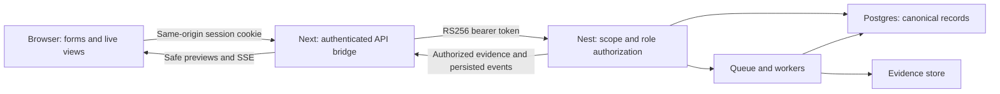

# Kase frontend implementation guide

Version 1.0 · 12 September 2026. Implement alongside the [PRD](02-web-app-prd.md); consult the [assessment](01-current-state-assessment.md) for existing gaps. Paths below are repository-relative. This document proposes implementation; it does not claim these new screens or bridge routes already exist.

## 1. Stack and boundaries

Retain the current pnpm workspace, Next.js App Router, React, TypeScript, Auth.js, and NestJS API. `apps/web/package.json` declares Next `^16.3.3`, React `^19.2.0`, and next-auth `5.0.0-beta.32`; these are manifest ranges, not independently verified deployment versions. Read `apps/web/AGENTS.md` and the installed Next documentation before implementation. Do not apply old Next conventions from memory.

The web app owns presentation, navigation, nonauthoritative form validation, session handling and a proposed same-origin API bridge. Nest owns project authorization, mutations, lifecycle, scope checks, evidence access, integration delivery and release decisions. Prisma model types are not a stable public browser API. Keep database access in the existing auth/server boundary; do not build a second product API by querying Prisma directly from pages.

Use server components for layouts and initial authenticated reads. Use client components for forms, filters, dialogs, streaming state and evidence interaction. Begin with the existing CSS token system and scoped component styles. A shared server-state cache library can be evaluated when implementing live lists, but none is currently installed in the web package; document any dependency decision and version rather than assuming one exists.

## 2. Proposed route map

Retain `/`, `/docs`, `/brand`, `/signin`, and the existing auth/intake routes. `/dashboard` becomes the project workspace entry. Project IDs are canonical path parameters; slugs are display/search metadata unless routing rules are explicitly changed.

Use the [screen, layout, and flow specification](04-screen-layout-flow-spec.md) as the route-by-route UI contract for page sections, responsive behavior, role surfaces, and flow maps.

| Proposed web route | Purpose | Stage / dependency |
|---|---|---|
| `/dashboard` | Accessible projects and no-project state | A; B01 access bootstrap |
| `/dashboard/projects/new` | Create project with attested scope | A |
| `/dashboard/projects/[projectId]` | Overview/setup checklist | A; aggregate read B03 for full metrics |
| `…/audits` and `…/audits/new` | Audit history and dispatch | A |
| `…/audits/[auditId]` | Audit detail; jobs/coverage/budget tabs | A; full coverage/budget B04 |
| `…/audits/[auditId]/findings` | Audit findings | A; expanded filters B03 |
| `…/audits/[auditId]/findings/[findingId]` | Claim, proof, source and actions | A read; B mutations |
| `…/audits/[auditId]/evidence/[evidenceId]` | Deep-linkable evidence viewer | A |
| `…/audits/[auditId]/inventory` | Canonical endpoints and drift | A |
| `…/findings` | Project-wide identity/history workspace | B; B05 |
| `…/audits/[auditId]/gate` and `…/gate-history` | Evaluation explanation/history | B; B06 |
| `…/waivers` and `…/approvals` | Requests/active exceptions/review | B; B07 |
| `…/suppressions` | Suppression review/reversal | B; B05 |
| `…/reports` | Audit report selection/export | B; B08 |
| `…/settings/[section]` | General, repositories, targets, scope, tokens, secrets, retention, members, policies, integrations, AI, test identities | Allowlisted sections; implemented settings A; others conditional |
| `/dashboard/organization/settings/[section]` | Organization retention, members/invitations and trail | Retention A; members/trail B02/B09 |

Here `…` means `/dashboard/projects/[projectId]`, not a literal route. Use shared authenticated and project layouts with loading, error, not-found and denied-access boundaries. Validate section names; do not use an arbitrary string to select privileged actions.

Suggested feature structure: `src/features/{access,projects,audits,findings,evidence,inventory,governance,settings}`. Shared UI belongs in `src/components/ui`; transport and decoding in `src/lib/api`; server-only session bridge in `src/lib/server`; normalized types in a versioned contracts package or `src/lib/contracts` until shared generation is ready. Keep route files thin.

## 3. Authentication and transport

Proposed web integration boundary (the bridge is new work):



### Existing behavior

`src/auth/index.ts` validates invited verified identities. Auth.js stores Kase user/org IDs in its JWT session. `GET /api/session-token` mints a 15-minute RS256 API token with `sub` and `org`, not project roles. The API verifies credentials then resolves project membership on each request. All API paths below are relative to `/api/v1`.

`apps/api/src/main.ts` does not configure CORS; `apps/web/next.config.ts` has no API proxy/rewrite. Do not assume separate-origin browser calls work. Native EventSource cannot set `Authorization: Bearer`.

### Recommended implementation: same-origin server bridge

Add explicit/allowlisted Next route handlers under `/api/kase/...` for browser reads, writes, streams and evidence. On every request, validate `auth()`, obtain trusted Kase IDs, mint/use a server-side short-lived API JWT, then forward to a configured internal API base. Nest still authorizes every upstream action. Use a server-only environment variable for this base, never a browser-selected URL.

- Forward only approved methods, paths, query keys and necessary headers, including idempotency and Last-Event-ID. Do not make an open proxy or forward caller cookies/Authorization to arbitrary hosts.
- Protect cookie-authenticated mutations against CSRF: verify trusted Origin and use an appropriate CSRF token strategy for custom bridge handlers. Auth.js protection on its own endpoints does not automatically cover new handlers.
- Mark user-specific responses and credential exchange `Cache-Control: private, no-store`; do not place protected fetches in shared static caches.
- Stream SSE bodies through without buffering; propagate abort/disconnect and set stream headers. Test reverse-proxy buffering and timeout behavior in the deployed environment.
- Proxy evidence bytes through authenticated requests. Strip unsafe response headers and supply safe download filenames, `nosniff`, content disposition and a controlled content type.
- Set upstream timeouts, avoid logging request bodies/credentials, preserve RFC 9457 errors and upstream status, and handle empty 204 responses without JSON parsing.
- If direct browser bearer transport is deliberately selected instead, configure explicit CORS, keep tokens only in memory, serialize refresh, and use fetch-based SSE parsing. Never put tokens in query strings or localStorage.

## 4. Role and capability bootstrap

**B01 is a backend prerequisite:** no current `/me`, project membership read, or capabilities endpoint was found. Add an org-session-scoped `GET /api/v1/me` (proposed path) or an equivalent agreed contract returning identity, organization role, accessible projects and per-project role/capabilities. Paginate project grants if necessary; each project route must refresh its current access context.

Example proposed contract, not today's API:

```ts
type ProjectRole = 'viewer' | 'operator' | 'approver' | 'admin';
type OrganizationRole = 'member' | 'admin';
type ProjectAccess = {
  projectId: string;
  role: ProjectRole;
  capabilities: string[]; // versioned server-owned action vocabulary
};
type CurrentUser = {
  user: { id: string; email: string; name: string | null };
  organization: { id: string; name: string; role: OrganizationRole };
  projects: ProjectAccess[];
};
```

Proposed capabilities include `audit.read`, `audit.create`, `audit.cancel`, `project.configure`, `token.manage`, `secret.manage`, `waiver.request`, `waiver.approve`, and `finding.suppress`. Backend maps explicit role allowlists to actions. The browser never compares role ranks. Current audit mutations allow `operator` and `admin`; future approver actions must not automatically include admin.

On project switch, cancel old requests/streams and clear project-specific sensitive state. Cache keys include org/project/audit IDs. On 401 attempt one session recovery where safe; on persistent 401 redirect to sign-in with an internal return path. On 403 refresh access, remove controls, clear protected data and present denied-access recovery. Do not assume every cross-project failure is 404: current scope denial can be 403, while child mismatch is often 404.

## 5. Actual API inventory for Stage A

“Existing” means inspected controller/service implementation. Check deployed API revision before integration. Aliases exist for some audit resources; choose nested routes consistently except inventory/cancel which are currently flat.

| Feature | Existing endpoint(s) | Actual shape / caveat | Authorization |
|---|---|---|---|
| Project list/create | `GET/POST /projects` | List `{data,nextCursor,hasMore}`; creation returns project graph | Org browser session; creator gets project admin |
| Project read/update/remove | `GET/PATCH/DELETE /projects/:id` | Read includes configured relationships; delete returns 204 | Read membership; write admin |
| Repositories | `GET/POST /projects/:id/repositories`; `PATCH/DELETE /projects/:id/repositories/:repositoryId` | List is array; credential is ID reference | Read membership; write admin |
| Targets | Same pattern with `targets/:targetId` | List is array; environment/auth modes constrained | Read membership; write admin |
| Scope | `GET/PUT /projects/:id/scope-policy` | PUT is complete replacement; do not send a partial patch | Read membership; write admin |
| Tokens | `GET/POST /projects/:id/tokens`; `DELETE …/:tokenId` | Creation reveals plaintext once; later metadata only | Admin, including list |
| Secrets | `GET/POST /projects/:projectId/secrets`; `POST …/:secretId/rotate`; `DELETE …/:secretId` | Metadata-only responses; revoke preserves record | Admin |
| Retention defaults | `GET/PUT /organizations/:id/evidence-policy` | Per-class defaults | Org session read; explicit org admin write |
| Retention override | `GET/PUT /projects/:id/evidence-policy` | Nullable class override restores org inheritance | Membership read; project admin write |
| Audit list/create | `GET/POST /projects/:projectId/audits` | GET bare array, newest first, capped at 100; POST 202 persisted audit/jobs | All project roles read; operator/admin create |
| Audit detail/jobs | `GET /projects/:projectId/audits/:auditId`; `GET …/jobs` | Audit object / bare jobs array; detail includes inventory summary | All project roles |
| Cancel | `POST /audits/:auditId/cancel` | Refetch audit after request; do not assume instant terminal state | Operator/admin |
| Events | `GET /projects/:projectId/audits/:auditId/events` | SSE; numeric sequence in event ID; Last-Event-ID resume | All project roles |
| Findings | `GET /projects/:projectId/audits/:auditId/findings`; `GET …/:findingId` | Bare array / object; list only severity/category/gateEligible | All project roles |
| Evidence | `GET /projects/:projectId/audits/:auditId/evidence`; `GET …/:evidenceId`; `GET …/:evidenceId/download` | Array / metadata / authenticated binary octet stream | All project roles |
| Inventory | `GET /audits/:auditId/inventory` | Custom snapshot and paging envelope; 409 when not ready | All project roles |
| AI configuration* | `GET/PUT /projects/:projectId/ai-configuration` | `{data}`; GET can contain null | Membership read; admin write |
| Test identities* | `GET/POST /projects/:projectId/test-identities`; `PATCH …/:identityId` | `{data}`; PATCH only `{active:false}`, not general edit | Membership read; admin write |
| Agent runs* | `GET /projects/:projectId/audits/:auditId/agent-runs` | `{data}` array; does not by itself supply complete coverage/budget DTO | All project members |

*M4 working-tree source; gate UI exposure on deployment capability/acceptance, not file existence.

### Decoder and pagination rules

Build one explicit decoder/adapter per resource. Do not flatten every result through `json.data`, or silently map unknown shapes to empty arrays. Contract mismatch is an error state with telemetry that excludes payload content. Normalize page results for UI only after decoding the endpoint's real shape.

Projects accept `limit` (default 50, max 200) and `cursor`. Audit history currently returns only the newest 100 with no cursor; label the limit and file B03 rather than inventing total pages. Findings currently have no pagination, accept a single exact `severity`/`category`, and interpret `gateEligible` as the string `true` or another provided value as false. Do not send comma-separated severity values to this implementation. Sorting is by finding ID, not the PRD's intended risk order. An initial client sort is acceptable only for a fully loaded bounded dataset and must not be presented as global server sorting.

Inventory accepts `method`, `path`, `source`, `statusClass` (`1xx`–`5xx`), `technology`, `drift`, `cursor`, `limit` (default 100, max 500). Response: `{id,auditId,previousInventoryId,generatedAt,summary,endpoints,drift,page:{nextCursor,hasMore}}`. Stable endpoint ordering is method/path template/id. Removed endpoints may exist only in the separate drift records; render removed changes from `drift`, not solely from current `endpoints`. A filtered current-endpoint list cannot represent a disappeared endpoint by itself.

## 6. Form and mutation contracts

### Project setup

Match `projects/dto/project.dto.ts` and nested DTOs. `name` is required, 1–120 characters; optional slug is lowercase alphanumeric with single hyphens, max 120. `scopePolicy` is mandatory; repository/targets optional.

Scope fields: nonempty `allowedHosts`; optional `deniedPaths`; integer `maxRequestsPerSecond` 1–1000; integer `maxRequestsPerAudit` 1–10,000,000; `destructiveAllowed` optional, default false; email `authorizationAttestedBy` required. Server owns host-pattern, fresh-attestation and destructive-authorization rules. Show current signed-in identity as the default attester, and ensure product/backend agree whether it must be server-derived before production release.

Repository: `provider: 'github'`, HTTPS `url`, `defaultBranch` 1–255 characters, optional `credentialId`. Target: `name`, HTTP(S) `baseUrl`, `environment: production|staging|beta|local`, optional `authMode: none|header|cookie|oauth|form`, `authCredentialId`, `buildInfoUrl`. Accepted auth-mode enum does not prove every mode is executable by every worker; expose only supported deployed behavior.

Private setup sequence: create project with attested scope → create same-project secret → create/update repository or target with returned secret ID. Do not invent a secret ID before the project exists. Preserve nonsecret draft state, clear secret inputs on successful submit/unmount, and warn about unsaved configuration changes.

### Audit create

Current DTO accepts only these fields:

```ts
type CreateAuditInput = {
  targetId?: string;
  repositoryId?: string;
  mode: 'smoke' | 'security' | 'full';
  category?: string;       // legacy smoke field
  categories?: string[];
  commitSha?: string;      // 7–40 hexadecimal characters
  maxWallTimeMs?: number;  // integer 60_000–3_600_000
};
```

Service rules today: smoke requires target and accepts `fixture_health`; security requires repository and accepts `sast`; full requires repository and accepts `sast`, `http`, `blackbox`, `whitebox`, with target required for `http`/`blackbox`. Full defaults to `sast,http`, not automatically to AI categories. AI selection depends on valid M4 configuration and deployment readiness. Do not advertise regression mode yet. Do not submit documented-but-unsupported `routeMap` or `budgetOverrides`; validation rejects unknown fields.

Send `Idempotency-Key` for create. Generate once per confirmed submission intent; reuse for a retry of the same payload. Generate a new key after user changes intent. Current service looks up project+key and returns an existing audit before comparing request body, so reusing a key for a changed payload can return the previous run. Ask backend to reject key/body conflicts and prove concurrent duplicate handling. Do not automatically retry unrelated POST/PATCH operations until their idempotency behavior is confirmed; the design convention is broader than inspected enforcement.

### Settings

Use current secret/token DTOs as the field authority when implementing their forms. Token plaintext must exist only in a transient creation-result view, with copy status and a close acknowledgement; never retain it in persistent caches. Secret plaintext is write-only. Retention classes are replayable evidence, nonreplayable evidence, raw tool output and agent transcript, with 1–365 day bounds and null project overrides for inheritance.

AI configuration uses provider/model/catalog revision, credential mode (`project_secret` or `platform`), optional credential secret ID and bounded token/call/context/output allocations from `AiConfigurationSchema`. Backend validates catalog status/capabilities and secret kind. Add B04's model catalog before building a picker; do not hardcode model names/prices. Deactivation is the only existing test-identity update; rotation belongs to the referenced secret workflow.

## 7. Streaming and state management

Separate three state machines:

1. Audit execution: `queued`, `running`, `completed`, `partial`, `failed`, `cancelled`.
2. Transport: connecting, live, stale/reconnecting, disconnected, unauthorized.
3. Gate evaluation: absent, evaluating, persisted PASS/FAIL/PARTIAL, evaluation error. The UI's pending/absent labels are not persisted gate outcomes.

Audit jobs currently document `queued`, `running`, `succeeded`, `failed`, `skipped`, `timed_out`. Treat unrecognized values conservatively and refresh canonical state; do not assign “success” as a default. Agent runs have their own states including waiting_for_tool and budget_exhausted; do not coerce them into job status strings.

Streaming algorithm:

1. Fetch canonical audit/jobs/findings; connect with last accepted sequence (initially zero). Treat events as invalidation signals until typed event contracts are agreed.
2. Decode SSE across chunk boundaries; handle multiline data, comments and named event types. Sequence comes from `id`, not the database event ULID.
3. Ignore repeated/older sequence numbers; if a gap appears, refresh canonical state. Coalesce event bursts to avoid one request per event.
4. On disconnect mark stale immediately, retain last trustworthy snapshot and timestamp, retry with bounded backoff, and refresh canonical reads every 10 seconds while disconnected. Never poll tools.
5. Reconnect with `Last-Event-ID`; native EventSource resumes within its own connection lifecycle, but manually recreated connections need explicit bridge/header handling. Do not assume it accepts custom initial headers.
6. On terminal event refetch final canonical data, then stop streaming and fallback timers. Persisted status wins over optimistic state.
7. Cancel requests/timers on project/audit switch or sign-out. Revalidate access on reconnect and periodically terminate/re-authorize long-lived streams. Current guards authorize stream establishment; this review did not establish midstream membership-revocation enforcement. Backend must close that gap before promising immediate streaming revocation.

The API's current SSE service polls persisted events internally. That is compatible with browser streaming and differs from browser polling. Events may have evolved beyond examples in the API README; contract tests must use actual producers, not copied illustrative payloads.

## 8. Evidence and trustworthy display

Evidence download is authenticated binary data, not a presigned URL JSON response. `EvidenceService` checks retention/access and verifies content hash before returning bytes. Honor 410 `EVIDENCE_EXPIRED` with retained metadata and a clear unavailable-artifact state; distinguish 404 and integrity/server failure. Request a fresh authenticated download for each access.

Render text/JSON escaped; never insert target HTML or AI output through unsanitized HTML. Treat SVG/HTML/PDF as active/untrusted document types: prefer download or an isolated sandbox without script privileges, not same-origin execution. Preview images only with controlled content types. Add preview size limits, truncation notices, download fallback, and revoke object URLs on close. Avoid making a browser memory blob of an unbounded artifact; stream large downloads through the bridge.

Shared components: `SeverityBadge`, `AuditStatusBadge`, `GateOutcome`, `ProvenanceBadge`, `ConfidenceBand`, `AdvisoryNotice`, `DegradationBanner`, `CoverageTable`, `BudgetMeter`, `EvidenceLink`, `ProblemPanel`, `StaleIndicator`, `PermissionBoundary`, `EmptyState`, `ConfirmDialog`, and a semantic table with URL-backed filters. Use text+icon alongside color. Display confidence as an ordinal band; AI prose is labeled. Budget gauges require actual denominators; unavailable metrics are not zero.

Finding detail order: claim/severity/eligibility → reproduction and evidence → source/correlation/provenance → impact → suggested patch → history → permitted actions. Preserve raw evidence access even when an interpretation fails. The current correlation illustration remains explanatory content until real correlated records exist.

## 9. Backend dependency register

No endpoint below is claimed implemented unless section 5 says so. Agree request/response schemas, role allowlists, error codes, pagination, idempotency and audit records before connecting mutations.

| ID | Needed contract/work | Owner and consumer | Delivery |
|---|---|---|---|
| B01 | Current-user/project roles/capabilities; accessible-project visibility; deployment feature capabilities | Backend with frontend contract review; shell/wizard | A prerequisite |
| B02 | Invite list/create/resend/revoke; org and project membership CRUD; verified invitation delivery, last-admin and approver-assignment constraints | Backend/security; member settings | Required for independent onboarding |
| B03 | Project summaries/trends; audit cursor pagination; findings pagination/multifilter/risk sort; stable counts | Backend; lists/overview | Bounded A UI possible; required before scale/full PRD filters |
| B04 | Coverage/passing-check reads, budget/request metrics, supported model catalog and typed event schema; stream revocation semantics | Backend/M4 owner; audit detail/AI | Partial A, full B |
| B05 | Finding identity/history, correlation/source read DTO, lifecycle transition API, suppression CRUD, possible-match decisions, safe replay | Backend/M5; investigation | B |
| B06 | Immutable gate policies, evaluate/read/history, exact rule/evidence explanations, server refresh after expiry/change | Backend/M6; gate/settings | B |
| B07 | Persisted waiver requests/decisions, expiry/revocation, concurrency control and separate approver | Backend/M6; approval queue | B |
| B08 | Report generation/read/download, GitHub/Jira configuration/delivery state/dedup | Backend/integrations; reports/settings/actions | B |
| B09 | Scoped paginated audit trail reads and actor-safe presentation | Backend; org/project history | B |

Existing docs propose `/findings/:id` lifecycle mutation, `/projects/:id/finding-identities`, `/finding-identities/:id/history`, `/projects/:id/suppressions`, `/projects/:id/waivers`, `/evidence/:id/replay`, `/audits/:id/gate`, and gate-policy/report/integration routes. These must be reconciled with implemented nesting conventions; do not call them because they appear in a design document.

The current `Waiver` model requires `approvedBy` and `approvedAt`; it does not represent a pending request. B07 needs a separate request/decision model or an explicitly redesigned lifecycle. A pending queue cannot be implemented correctly by inserting fake approvers or holding requests only in browser state. Require server-authorized state transitions, revision/conflict checks, immutable actor/time/reason history and expiry-bounded applicability.

## 10. Error and recovery mapping

| Response/code | UI behavior |
|---|---|
| 401 / UNAUTHENTICATED | One controlled session recovery; then sign-in preserving safe internal destination |
| 403 / FORBIDDEN / PROJECT_SCOPE_DENIED | Denied-access state, clear scoped data, refresh access; no endless retry |
| 404 / NOT_FOUND | Resource unavailable within current context; do not reveal foreign ownership |
| 409 / CONFLICT | Preserve draft and refresh current version; offer explicit retry after reconciliation |
| 409 / INVENTORY_NOT_READY | Building state; follow audit progress; not a zero-result inventory |
| 410 / EVIDENCE_EXPIRED | Metadata/tombstone remains; disable replay/preview and explain retention |
| 422 / VALIDATION_FAILED | Field messages when available; otherwise form-level detail and focus summary |
| 422 / SCOPE_VIOLATION / ATTESTATION_REQUIRED / ATTESTATION_STALE | Explain blocked audit; admin repair link if permitted |
| 422 / AI_CONFIGURATION_REQUIRED / BUDGET_EXCEEDED | Explain configuration/budget prerequisite without secret/provider internals |
| 429 / RATE_LIMITED | Respect Retry-After when present; prevent rapid repeated submissions |
| 5xx or network failure | Retain last valid read, mark stale; uncertain mutation gets safe reconciliation, not blind replay |

Parse RFC 9457 `type,title,status,detail,instance,code` plus optional field errors, but tolerate malformed/non-JSON network responses. Never show a server stack trace or stringify a credential-containing request into telemetry.

## 11. Work packages and definition of done

| Package | Work and dependency | Stories / observable completion |
|---|---|---|
| FE-01 | Contract adapters, bridge, B01 capabilities, authenticated layout/account controls | US-02–04,22; real API read and every denied-role case pass |
| FE-02 | Project browser, setup wizard, repositories/targets/scope, no-project and read-only states | US-03,09; real project creation and credential-reference setup succeed |
| FE-03 | Audit list/wizard, idempotency, live detail/cancel/recovery | US-05–06; reconnect and double-submit scenarios end with correct persisted state |
| FE-04 | Findings/detail/evidence/inventory; initial bounded filters and honest unavailable data | US-07–08; escaped evidence, 410 and removed-endpoint drift verified |
| FE-05 | Tokens/secrets/retention and conditional M4 controls | US-10–12; once-only/write-only secrets behavior and all admin denials verified |
| FE-06 | B02 membership/invite screens and account-access recovery | US-17,22; org/project roles remain independent, no last-admin lockout |
| FE-07 | B05–07 identity history, possible matches, gates, requests/approvals/suppressions | US-13–16; separate approval, expiry and PARTIAL tested |
| FE-08 | B08–09 reports/integrations/history; end-to-end release journey | US-18–20; correct external delivery state and deterministic rerun demonstrated |
| FE-09 | Cross-cutting browser/accessibility/performance acceptance, run incrementally with each package | US-21; deployed critical workflows usable at required viewports/input modes |

Implement FE-01–05 against today's supported backend while B05–09 are developed. FE-06 timing determines whether Stage A can claim independent onboarding. Do not ship an actionable placeholder for a missing feature; hide unavailable navigation or provide an explicit informative state only when it helps the user understand a dependency.

For every package: implemented routes and states; decoder/contract fixtures from actual API responses; successful allowed and denied-role paths; no secrets in persistence/logs; keyboard and narrow-screen review; tests/checks appropriate to the changed behavior; documented backend limitations. Avoid estimates in weeks until B01–09 have owners and accepted contracts.

## 12. Validation plan and existing tool caveats

Existing web tests cover authentication helpers only, under Jest with node environment and `.spec.ts` matching. Add a browser E2E harness and component test environment deliberately; the current configuration does not provide browser interaction coverage. The `lint` script is `next lint`; validate against the installed Next CLI and replace with a supported configured linter if needed. Do not call it a working gate based only on the package script.

Required test matrix:

- Every project role × allowed reads/start/cancel/configuration/approval; org member/admin independently; token/session separation; cross-project child IDs; revoked membership.
- Invite valid/expired/unverified/missing, no-project state, session expiry and return-path validation.
- Project validation, duplicate slug, missing/foreign/revoked secret, production re-attestation and unsaved form changes.
- Audit supported/unsupported modes, two rapid submits, uncertain response retry with same key, changed-payload new key, cancellation races.
- SSE duplicate/gap/reconnect/malformed event, stream authorization expiry/revocation, canonical terminal refresh and timer cleanup.
- Findings filters/pagination as actually supported, historical identity, advisory/unverified/degraded/no-evaluation state combinations.
- Evidence text/JSON/image/HTML payload safety, oversized artifacts, 410/404/integrity errors, no token in URLs or saved state.
- Inventory building/first baseline/current vs removed drift rows and cursor/filter resets.
- Governance requester=approver denial, concurrent decision, waiver expiry, suppression reversal, immutable evaluation history and FAIL/PARTIAL handling.
- Keyboard-only flows, screen-reader announcements, dialog focus restoration, 200% zoom, reduced motion, required responsive widths, contrast and axe scans.

Use a controlled seeded environment with separate users for every role, two projects, an org admin without project membership, expired evidence, and running/completed/degraded audits. Do not bypass real authorization to make UI tests pass. Browser fixtures may simulate missing Stage B APIs during component development, but such tests do not establish integrated delivery.

Baseline commands when the toolchain is available: web Jest, TypeScript no-emit, production build, supported lint, then E2E/axe against the test deployment. Root `pnpm dev` starts the API, not the web app. Assign distinct ports and configure the server bridge API base. Avoid modifying the current unrelated M4 work to obtain a green frontend check.

## 13. Source index

| Source | Authority |
|---|---|
| `apps/web/src/app`, `apps/web/src/auth` | Existing web pages, CSS, identity/session behavior |
| `apps/api/src/auth/{roles.ts,roles.guard.ts,project-scope.guard.ts,organization-admin.guard.ts}` | Actual role/scope rules |
| `apps/api/src/projects`, `tokens`, `secrets`, `retention`, `organizations` | Setup/settings contracts |
| `apps/api/src/orchestrator`, `audit-events`, `findings`, `evidence`, `recon` | Implemented operational read/write/stream contracts |
| `apps/api/src/agent-runtime/{ai-configuration.controller.ts,test-identities.controller.ts,agent-run.controller.ts}` | M4 in-progress web-relevant contracts |
| `packages/db/schema.prisma` | Persisted data model; not a claim of HTTP endpoint availability |
| `docs/09-findings`, `docs/12-policy-gate`, `docs/14-api`, `docs/16-web`, `docs/17-security`, `TASKS.md` | Product invariants, intended APIs/screens and roadmap |

When a frontend implementation reveals a contract mismatch, update the adapter, API documentation and acceptance scenario together. Do not hide the mismatch by deriving authorization, evidence eligibility or release outcomes in client code.


