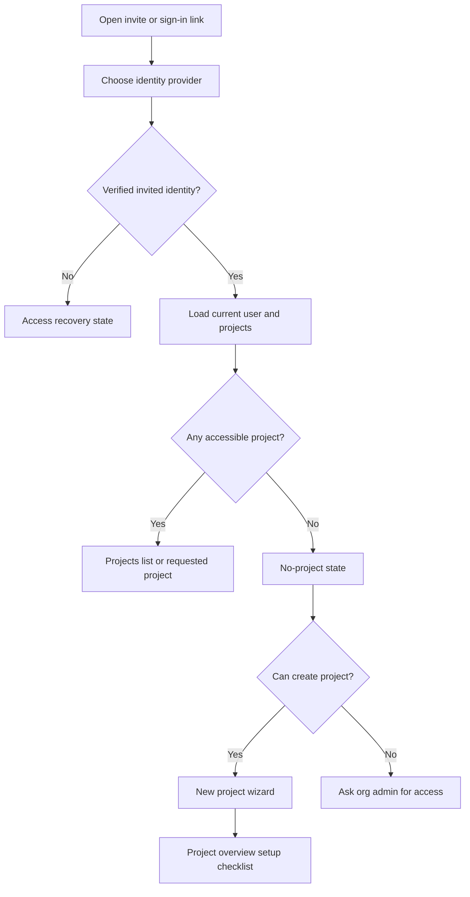
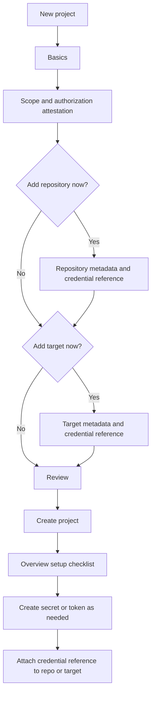
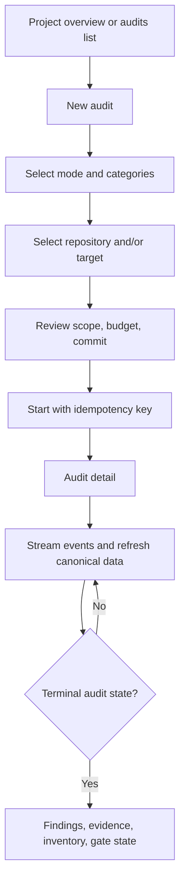
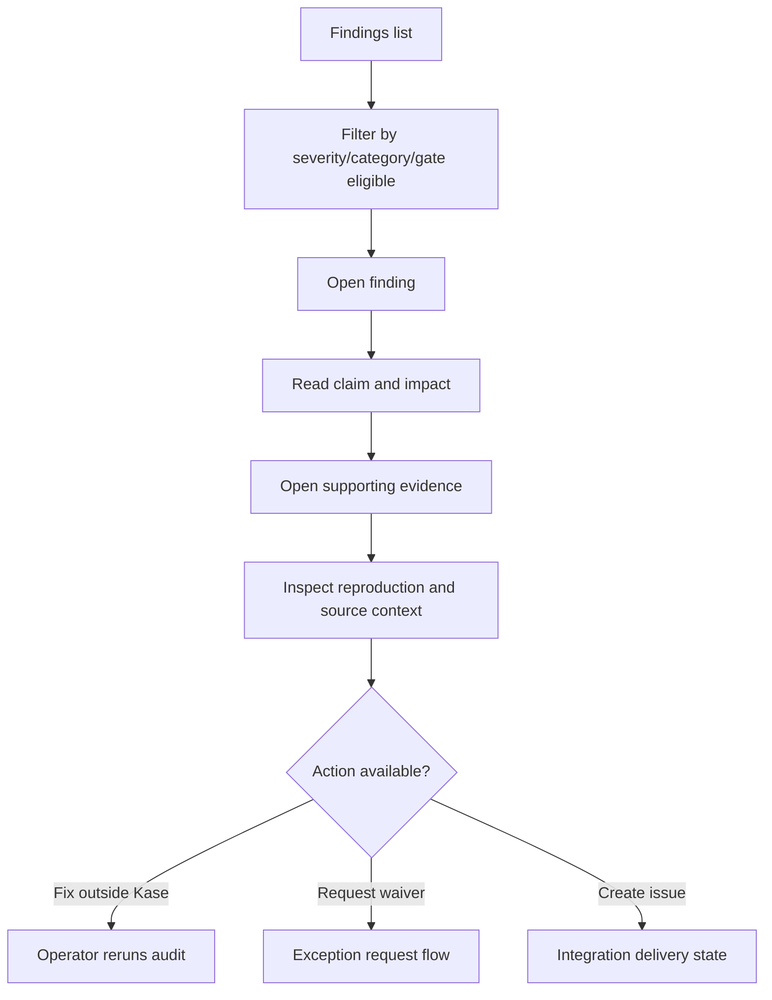
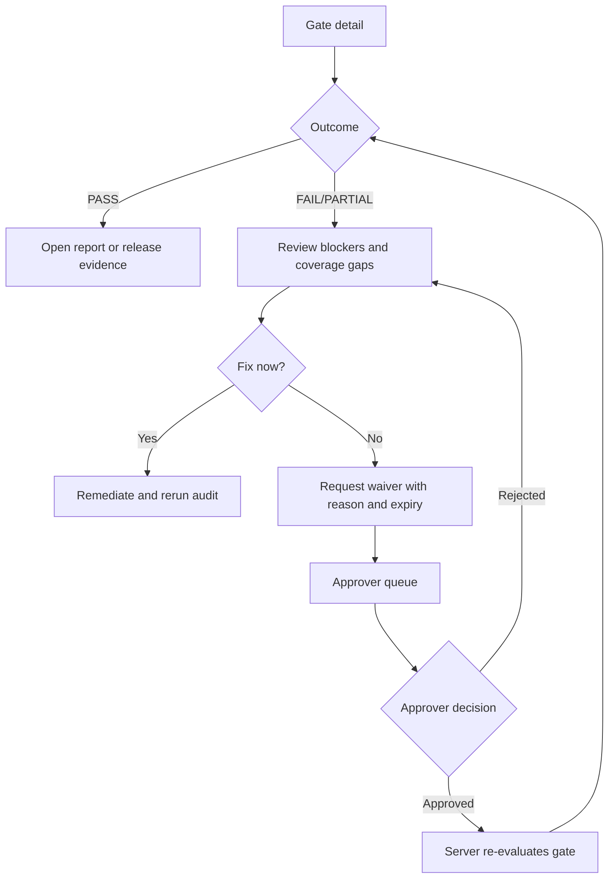
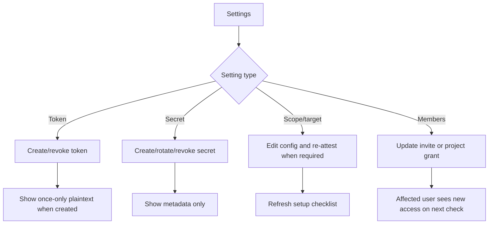

# Kase web app screen, layout, and flow specification

Version 1.0 - 14 September 2026. Companion to the [PRD](02-web-app-prd.md) and [frontend implementation guide](03-frontend-implementation.md). This document describes the target interface shape for the web app. It is a product and frontend build spec, not a claim that these screens already exist.

## 1. Interface principles

Kase is an operational assurance console. The interface should feel quiet, dense, trustworthy, and fast to scan. It should avoid marketing-style page composition once the user is authenticated. The main job is to answer four questions quickly:

- What project, target, audit, commit, and role am I looking at?
- Can this user act here, or only read?
- What evidence supports the finding or decision?
- What changed since the previous run?

Never use empty zeroes where the system lacks data. Prefer explicit states such as "Not run", "Not evaluated", "Inventory building", "Evidence expired", and "Unavailable in this deployment". Mutating controls are shown only when the server capability exists and the current user is allowed to use it.

## 2. Authenticated app layout

The authenticated app uses a persistent workspace shell. Public marketing navigation is not reused inside the console.

```text
+--------------------------------------------------------------------------------+
| Top bar: Kase mark | organization | project switcher | role | help | account   |
+----------------------+---------------------------------------------------------+
| Primary nav          | Page header: breadcrumb, title, status, primary action  |
| - Overview           |---------------------------------------------------------|
| - Audits             | Context summary band: target, commit, scope, freshness  |
| - Findings           |---------------------------------------------------------|
| - Inventory          | Main work area: table/detail/form depending on screen   |
| - Gate               |                                                         |
| - Reports            |                                                         |
| - Settings           |                                                         |
|                      |---------------------------------------------------------|
| Org settings link    | Secondary rail/drawer when useful: filters, timeline    |
+----------------------+---------------------------------------------------------+
```

### Global regions

| Region | Contents | Behavior |
|---|---|---|
| Top bar | Product mark, organization name, project selector, project role/capability label, help link, account menu | Stays visible. Project switch cancels streams and clears project-scoped state. |
| Left nav | Project sections plus org settings entry when allowed | Items are hidden or disabled with an unavailable state when backend capability is absent. Current route is keyboard and screen-reader identifiable. |
| Page header | Breadcrumb, H1, concise state badges, primary action | Primary action is singular: create project, run audit, request waiver, approve, save, or export. |
| Context band | Target, environment, audit status, commit, policy version, freshness, retention warnings | Appears on project/audit/finding/governance pages. Avoids oversized cards. |
| Main work area | Tables, forms, detail panes, evidence previews | Supports deep links, URL-backed filters, loading/error/empty states. |
| Secondary rail | Filters, timeline, related evidence, policy rules, or setup checklist | Optional. Collapses into tabs or drawer below tablet width. |

### Responsive rules

At 1280 px and wider, use a fixed left nav and a two-column content grid where detail screens need supporting context. At 768-1279 px, keep the top bar and collapse the secondary rail below the main content. At 360-767 px, collapse navigation behind a menu, make tables switch to stacked rows, keep the primary action reachable near the header, and never hide evidence/gate reasons behind hover-only interactions.

## 3. Screen inventory

### Public and access screens

| Screen | Sections | Primary action | Roles |
|---|---|---|---|
| Public home | Product promise, supported workflow, request-access intake, docs link | Request access or sign in | Anonymous |
| Sign in | Provider choices, return-path context, invite recovery | Continue with provider | Pending invitee, existing user |
| Access denied/recovery | Reason, allowed recovery, sign out/switch account | Return to projects or sign in | Any authenticated user |

Sign-in copy should be specific about denied states: expired invite, unverified provider email, no project access, provider unavailable, or session expired. Do not expose environment variable names in production UI.

### Project workspace screens

| Screen | Sections | Primary action | Roles |
|---|---|---|---|
| Projects | Project list, role badges, last audit, setup status, no-project state | Create project when allowed | Org member/admin |
| New project | Basics, attested scope, optional repository, optional target, review | Create project | Org member/admin, subject to product decision |
| Project overview | Setup checklist, latest audit, findings summary, inventory drift, release state when available | Run audit or continue setup | Viewer/operator/approver/admin, role-gated |
| Project settings | General, repositories, targets, scope, tokens, secrets, retention, AI/test identities when available | Save section-specific change | Project admin; read-only summary for other members |

Project overview should use a compact operational dashboard layout:

```text
Header: Project name | role | environment | Run audit
Context band: target + repo + commit + scope attestation + retention

Latest audit strip: status, started, duration, mode, categories, actor
Findings table preview: gate eligible, severity, title, status, evidence count
Inventory drift preview: added/changed/removed endpoints
Setup checklist rail: scope, target, repo, credentials, AI readiness
```

### Audit and investigation screens

| Screen | Sections | Primary action | Roles |
|---|---|---|---|
| Audits list | Filters, audit rows, mode/categories, target/repo/commit, status, actor | New audit | Viewer read; operator/admin create |
| New audit | Mode, category picker, repository/target, commit, scope/budget review | Start audit | Operator/admin |
| Audit detail | Live status, jobs, events, coverage, budgets, findings, evidence, inventory links | Cancel while running | Viewer read; operator/admin cancel |
| Findings list | Filter bar, risk ordered rows, evidence count, gate eligibility, provenance, status | Export/report when supported | All project roles read |
| Finding detail | Claim, impact, reproduction, evidence, source/correlation, patch, history, actions | Request waiver/replay/create issue when supported | Viewer read; operator/approver/admin actions by capability |
| Evidence viewer | Metadata, retention state, redacted preview, download, linked findings | Download | All project roles read |
| Inventory | Endpoint table, drift filters, baseline selector, endpoint detail | None in Stage A | All project roles read |

Audit detail should not look like a single long log page. Use tabs or segmented views for Overview, Jobs, Events, Findings, Evidence, and Inventory. The Overview tab should show the current terminal truth first, then supporting details.

```text
Audit header: status | mode | target/repo | commit | actor | Cancel
Health band: live/stale | last event | request budget | degraded categories

Left/main:
- Execution timeline
- Job table with status, attempts, duration, reason
- Coverage or unavailable state

Right/supporting:
- Scope summary
- Related setup
- Gate/evaluation state when available
```

Finding detail is the main trust screen. It should lead with the claim and severity, then immediately show proof. Suggested patches and AI explanation sit below evidence, with labels that distinguish deterministic correlation from AI inference.

### Governance and release screens

| Screen | Sections | Primary action | Roles |
|---|---|---|---|
| Gate detail | Outcome, policy version, commit, blocking rules, coverage gaps, active waivers | Request exception when allowed | All project roles read; operator/approver/admin request by capability |
| Gate history | Prior evaluations, policy versions, commits, outcomes, waiver effects | Open evaluation | All project roles read |
| Approvals | Pending requests, evidence context, requester, expiry, decision history | Approve or reject | Project approver |
| Waivers | Active, pending, rejected, expired, revoked waiver table | Request waiver | Operator/approver/admin by capability |
| Suppressions | Suppressed fingerprints, reason, actor, reversal history | Revoke suppression | Project approver |
| Reports | Report list, generation state, exports, evidence-linked summaries | Generate/export when supported | All read; allowed roles generate |

Gate screens are authoritative only when backed by persisted server evaluation. If no gate exists, the screen should say "No evaluation" and explain the required audit/backend dependency without inventing a pass/fail score.

### Organization administration screens

| Screen | Sections | Primary action | Roles |
|---|---|---|---|
| Organization settings | Retention defaults, member list, invitation list, admin history | Invite member or save retention | Org admin |
| Member detail | Organization role, project grants, invite/session status, recent admin changes | Update grants | Org admin; pending backend |

Organization admin and project admin are separate contexts. An org admin without project membership can manage organization-level access and defaults but cannot inspect project findings unless the server grants project access.

## 4. Navigation model

Use URL-backed state for page identity, selected tabs, filters, and cursors. Avoid storing sensitive evidence or tokens in URLs. Recommended primary navigation:

```text
/dashboard
/dashboard/projects/new
/dashboard/projects/:projectId
/dashboard/projects/:projectId/audits
/dashboard/projects/:projectId/audits/new
/dashboard/projects/:projectId/audits/:auditId
/dashboard/projects/:projectId/audits/:auditId/findings
/dashboard/projects/:projectId/audits/:auditId/findings/:findingId
/dashboard/projects/:projectId/audits/:auditId/evidence/:evidenceId
/dashboard/projects/:projectId/audits/:auditId/inventory
/dashboard/projects/:projectId/audits/:auditId/gate
/dashboard/projects/:projectId/settings/:section
/dashboard/organization/settings/:section
```

Breadcrumb examples:

- Projects / Acme API / Audits / 2026-09-14 smoke
- Projects / Acme API / Audit / Findings / Reflected XSS in search
- Projects / Acme API / Settings / Scope
- Organization / Settings / Members

## 5. Core user flows

### Flow A: First session to first project



### Flow B: Project setup



### Flow C: Run and monitor audit



### Flow D: Investigate finding



### Flow E: Release decision and exception



### Flow F: Admin changes access or credentials



## 6. Role-specific surface

| Role | Default landing | Visible navigation | Hidden or denied actions |
|---|---|---|---|
| Anonymous | Public home | Public pages, sign in, docs | Any workspace route |
| Pending invitee | Sign in/recovery | Provider sign-in, invite recovery | Project data until invitation resolves |
| Org member | Projects | Projects, create project if retained by product decision | Org admin settings |
| Org admin | Organization settings or projects | Org settings, retention, members/invites when implemented | Project findings without project grant |
| Project viewer | Project overview | Overview, audits, findings, evidence, inventory, gate/report read states | Run/cancel audit, settings mutation, waiver decision |
| Project operator | Project overview | Viewer navigation plus run/cancel, eventual replay/request actions | Project configuration, token/secret management, approval decisions |
| Project approver | Approval queue or project overview | Viewer navigation plus approvals, waivers/suppressions when implemented | Start audit, project configuration, token/secret management |
| Project admin | Project overview/setup | All project settings, run/cancel, token/secret/retention controls | Org admin settings unless also org admin; approver-only decisions unless granted |
| API token/CI | No browser surface | Linked audit/gate/report pages for humans | Organization routes and browser-only session actions |

## 7. Component layout patterns

Use these reusable patterns across screens:

| Pattern | Purpose | Notes |
|---|---|---|
| `WorkspaceShell` | Authenticated top bar, project selector, left nav | Server loads session and capability bootstrap. |
| `PageHeader` | Breadcrumb, title, status badges, primary action | Keeps action placement consistent. |
| `ContextBand` | Compact metadata for target, repo, commit, role, freshness | Uses text plus badges, never color alone. |
| `FilterToolbar` | Search, segmented filters, sort, reset | Backed by URL params and server-supported filters. |
| `DataTable` | Audits, findings, inventory, waivers, members | Stacked card rows on mobile; preserves row actions. |
| `SplitDetail` | Finding/evidence/gate detail with supporting rail | Rail becomes tabs/drawer on smaller screens. |
| `StateBlock` | Empty/loading/denied/unavailable/stale states | Copy names the condition and next valid action. |
| `PermissionBoundary` | Capability-aware control rendering | Server is authoritative; client only improves presentation. |
| `ConfirmDialog` | Cancel/revoke/rotate/destructive settings | Shows exact object and consequence. |
| `EvidencePreview` | Safe previews and downloads | No unsanitized HTML or same-origin active documents. |

## 8. Screen-level acceptance

- Every screen has loading, empty, error, denied, and stale states where applicable.
- Every mutating action has pending, success, validation-error, conflict, forbidden, and uncertain-network handling.
- Every table has keyboard reachable filters, sortable columns only when supported, and a usable narrow-screen representation.
- Every role sees the right read/action surface after reload, direct deep link, project switch, and access revocation.
- Audit live screens recover from stream disconnect without losing the last canonical state.
- Evidence screens distinguish unavailable metadata, expired content, unsupported previews, and failed downloads.
- Gate screens never imply a release decision without persisted policy evaluation.
- Settings screens never persist secret plaintext in state caches, localStorage, URLs, analytics, or logs.
